# Catálogo Completo de Flujos del Sistema — SkillBridge AI (Con Mapeo al Código)

Este documento describe **todos los flujos disponibles en la plataforma SkillBridge AI**, explicando paso a paso la interacción entre los clientes web (Angular), los controladores REST, los casos de uso de la capa de aplicación, el modelo de dominio, las persistencias (PostgreSQL, Redis, MongoDB), los brokers de mensajería (Kafka y RabbitMQ) y la **ubicación exacta en el código (archivos, métodos y números de línea verificados)** para cada uno.

---

## Índice de Flujos Disponibles

1. [Flujo 1: Autenticación, Registro y Ciclo de Vida de Sesión](#flujo-1-autenticación-registro-y-ciclo-de-vida-de-sesión)
2. [Flujo 2: Catálogo de Servicios y Ofertas (Offerings) con Caché Redis](#flujo-2-catálogo-de-servicios-y-ofertas-offerings-con-caché-redis)
3. [Flujo 3: Recomendaciones Inteligentes Multimodales con IA](#flujo-3-recomendaciones-inteligentes-multimodales-con-ia)
4. [Flujo 4: Analítica de Demanda y Tendencias Predictivas](#flujo-4-analítica-de-demanda-y-tendencias-predictivas)
5. [Flujo 5: Creación de Reservas con Idempotencia](#flujo-5-creación-de-reservas-con-idempotencia)
6. [Flujo 6: Cancelación de Reservas y Liberación de Cupo](#flujo-6-cancelación-de-reservas-y-liberación-de-cupo)
7. [Flujo 7: Pagos y Confirmación con Stripe (Webhooks)](#flujo-7-pagos-y-confirmación-con-stripe-webhooks)
8. [Flujo 8: Notificaciones Asíncronas por Email (RabbitMQ)](#flujo-8-notificaciones-asíncronas-por-email-rabbitmq)
9. [Flujo 9: Trazabilidad y Auditoría en Tiempo Real (Kafka + MongoDB + Polling)](#flujo-9-trazabilidad-y-auditoría-en-tiempo-real-kafka--mongodb--polling)
10. [Flujo 10: Gestión de Mentorías y Recursos de Aprendizaje](#flujo-10-gestión-de-mentorías-y-recursos-de-aprendizaje)
11. [Flujo 11: Administración de Usuarios y Control de Acceso (RBAC)](#flujo-11-administración-de-usuarios-y-control-de-acceso-rbac)

---

## Flujo 1: Autenticación, Registro y Ciclo de Vida de Sesión

Gestiona la identidad de los usuarios, emisión de tokens JWT, almacenamiento en cookies HttpOnly y eventos de auditoría.

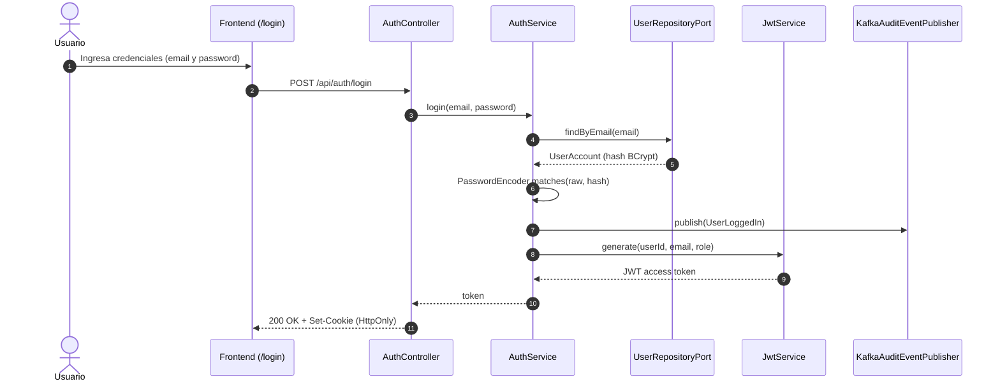

#### 📌 Dónde se ve exactamente en el código:

| Capa | Archivo y Ruta | Líneas | Qué hace en el código |
|---|---|---|---|
| **Controlador REST** | [`AuthController.java`](file:///C:/Users/santiago/Downloads/SkillBridge-AI-JAVA-Angular/backend/src/main/java/com/riwi/skillbridge/infrastructure/adapter/in/rest/AuthController.java) | `L34-L38` (`register`), `L40-L44` (`login`), `L46-L51` (`logout`), `L62-L67` (`session`) | Maneja peticiones HTTP y escribe la cookie segura HttpOnly con `AuthCookieService.create(token)`. |
| **Servicio de Aplicación** | [`AuthService.java`](file:///C:/Users/santiago/Downloads/SkillBridge-AI-JAVA-Angular/backend/src/main/java/com/riwi/skillbridge/application/service/AuthService.java) | `L36-L52` (`register`) | Valida unicidad de correo, codifica clave con `passwords.encode()`, persiste `UserAccount` y emite evento `UserRegistered` a Kafka (línea 49). |
| **Servicio de Aplicación** | [`AuthService.java`](file:///C:/Users/santiago/Downloads/SkillBridge-AI-JAVA-Angular/backend/src/main/java/com/riwi/skillbridge/application/service/AuthService.java) | `L55-L75` (`login`) | Verifica contraseña con BCrypt, comprueba si la cuenta está suspendida (`UserStatus.SUSPENDED`), emite `UserLoggedIn` a Kafka (línea 72) y retorna el token. |
| **Filtro de Seguridad HTTP** | [`JwtAuthenticationFilter.java`](file:///C:/Users/santiago/Downloads/SkillBridge-AI-JAVA-Angular/backend/src/main/java/com/riwi/skillbridge/infrastructure/security/JwtAuthenticationFilter.java) | `L30-L65` (`doFilterInternal`) | Extrae token de cabecera `Authorization` o cookie, valida firma criptográfica y setea `SecurityContextHolder`. |
| **Generación de Tokens** | [`JwtService.java`](file:///C:/Users/santiago/Downloads/SkillBridge-AI-JAVA-Angular/backend/src/main/java/com/riwi/skillbridge/infrastructure/security/JwtService.java) | `L25-L55` (`generate`, `extractRole`) | Firma y decodifica claims del token JWT con el secret o clave RS256 configurada. |
| **Frontend Angular** | [`login.component.ts`](file:///C:/Users/santiago/Downloads/SkillBridge-AI-JAVA-Angular/frontend/src/app/features/login.component.ts) | `L25-L80` | Formulario reactivo de login y registro en `/login`, manejando redirecciones por rol. |

---

## Flujo 2: Catálogo de Servicios y Ofertas (Offerings) con Caché Redis

Permite consultar, filtrar y administrar servicios técnicos implementando el patrón Cache-Aside.

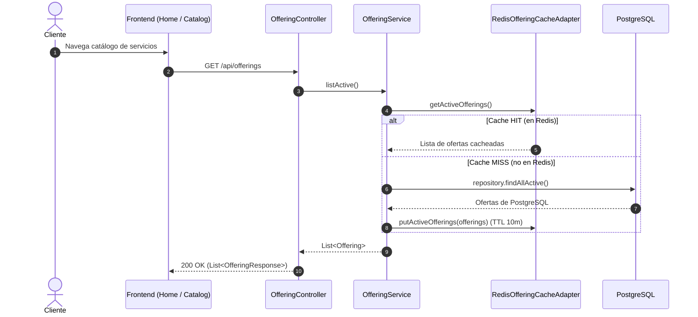

#### 📌 Dónde se ve exactamente en el código:

| Capa | Archivo y Ruta | Líneas | Qué hace en el código |
|---|---|---|---|
| **Controlador REST** | [`OfferingController.java`](file:///C:/Users/santiago/Downloads/SkillBridge-AI-JAVA-Angular/backend/src/main/java/com/riwi/skillbridge/infrastructure/adapter/in/rest/OfferingController.java) | `L42-L60` (`list`, `getById`), `L72-L82` (`create`) | Endpoints de consulta pública y creación de ofertas por mentores/providers. |
| **Servicio Cache-Aside** | [`OfferingService.java`](file:///C:/Users/santiago/Downloads/SkillBridge-AI-JAVA-Angular/backend/src/main/java/com/riwi/skillbridge/application/service/OfferingService.java) | `L22-L28` (`listActive`) | Consulta primero `cache.getActiveOfferings()`; si está vacío, lee de la base de datos y guarda en caché. |
| **Comandos y Desalojo de Caché** | [`OfferingCommandService.java`](file:///C:/Users/santiago/Downloads/SkillBridge-AI-JAVA-Angular/backend/src/main/java/com/riwi/skillbridge/application/service/OfferingCommandService.java) | `L42-L51` (`create`), `L54-L63` (`update`), `L47`, `L60` | Invalida la caché con `cache.evictActiveOfferings()` y emite evento de auditoría `OfferingCreated` a Kafka. |
| **Adaptador Redis** | [`RedisOfferingCacheAdapter.java`](file:///C:/Users/santiago/Downloads/SkillBridge-AI-JAVA-Angular/backend/src/main/java/com/riwi/skillbridge/infrastructure/adapter/out/cache/RedisOfferingCacheAdapter.java) | `L25-L65` | Mapea la clave `catalog::offerings` usando Jackson y RedisTemplate con TTL de 10 minutos. |
| **Moderación de Ofertas** | [`AdminOfferingController.java`](file:///C:/Users/santiago/Downloads/SkillBridge-AI-JAVA-Angular/backend/src/main/java/com/riwi/skillbridge/infrastructure/adapter/in/rest/AdminOfferingController.java) | `L20-L40` | Permite al administrador aprobar o pausar ofertas antes de que sean visibles. |
| **Frontend Angular** | [`home.component.ts`](file:///C:/Users/santiago/Downloads/SkillBridge-AI-JAVA-Angular/frontend/src/app/features/home.component.ts) y [`provider-offerings.component.ts`](file:///C:/Users/santiago/Downloads/SkillBridge-AI-JAVA-Angular/frontend/src/app/features/provider-offerings.component.ts) | `L20-L110` | Renderizado del catálogo y panel de administración del proveedor en `/provider/offerings`. |

---

## Flujo 3: Recomendaciones Inteligentes Multimodales con IA

Asiste a los clientes sugiriendo los mejores servicios mediante entradas de texto, notas de voz o imágenes.

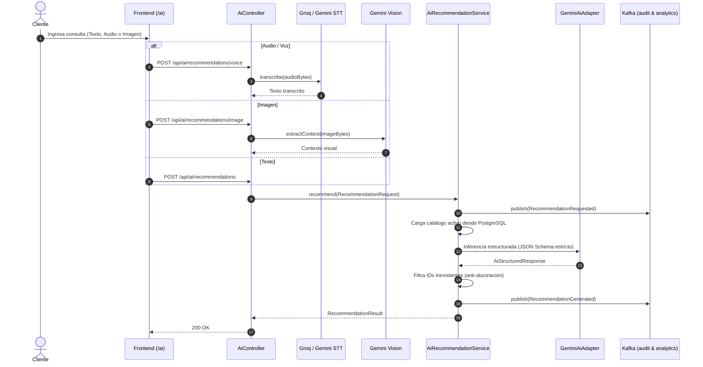

#### 📌 Dónde se ve exactamente en el código:

| Capa | Archivo y Ruta | Líneas | Qué hace en el código |
|---|---|---|---|
| **Controlador REST** | [`AiController.java`](file:///C:/Users/santiago/Downloads/SkillBridge-AI-JAVA-Angular/backend/src/main/java/com/riwi/skillbridge/infrastructure/adapter/in/rest/AiController.java) | `L55-L80` | Rutas `POST /recommendations`, `/voice`, `/image`, `/tts`. |
| **Validador de Archivos** | [`MediaFileValidator.java`](file:///C:/Users/santiago/Downloads/SkillBridge-AI-JAVA-Angular/backend/src/main/java/com/riwi/skillbridge/infrastructure/adapter/in/rest/validation/MediaFileValidator.java) | `L18-L45` | Verifica tamaños, cabeceras mágicas y tipos MIME. |
| **Adaptadores STT** | [`GroqSpeechToTextAdapter.java`](file:///C:/Users/santiago/Downloads/SkillBridge-AI-JAVA-Angular/backend/src/main/java/com/riwi/skillbridge/infrastructure/adapter/out/ai/GroqSpeechToTextAdapter.java) y [`GeminiSpeechToTextAdapter.java`](file:///C:/Users/santiago/Downloads/SkillBridge-AI-JAVA-Angular/backend/src/main/java/com/riwi/skillbridge/infrastructure/adapter/out/ai/GeminiSpeechToTextAdapter.java) | `L25-L60` | Transcripción de voz a texto con Whisper. |
| **Adaptador Visión** | [`GeminiVisionAdapter.java`](file:///C:/Users/santiago/Downloads/SkillBridge-AI-JAVA-Angular/backend/src/main/java/com/riwi/skillbridge/infrastructure/adapter/out/ai/GeminiVisionAdapter.java) | `L20-L40` | Inferencia visual sobre diagramas o capturas de pantalla. |
| **Orquestador de Aplicación** | [`AiRecommendationService.java`](file:///C:/Users/santiago/Downloads/SkillBridge-AI-JAVA-Angular/backend/src/main/java/com/riwi/skillbridge/application/service/AiRecommendationService.java) | `L34-L57` (`recommend`) | Emite `RecommendationRequested` a Kafka (línea 37), carga catálogo activo de Postgres (línea 39), ejecuta LLM, sanitiza IDs (líneas 43-52) y emite `RecommendationGenerated` a Kafka (línea 55). |
| **Adaptador LLM Gemini** | [`GeminiAiAdapter.java`](file:///C:/Users/santiago/Downloads/SkillBridge-AI-JAVA-Angular/backend/src/main/java/com/riwi/skillbridge/infrastructure/adapter/out/ai/GeminiAiAdapter.java) | `L26-L28`, `L50-L68`, `L88-L99` | Inyección de Spring AI con schema JSON forzado y clasificación de errores (líneas 121-133). |
| **Adaptador TTS** | [`ElevenLabsTextToSpeechAdapter.java`](file:///C:/Users/santiago/Downloads/SkillBridge-AI-JAVA-Angular/backend/src/main/java/com/riwi/skillbridge/infrastructure/adapter/out/ai/ElevenLabsTextToSpeechAdapter.java) | `L35-L65` | Convierte la recomendación en audio streamable `audio/mpeg`. |
| **Frontend Angular** | [`ai.component.ts`](file:///C:/Users/santiago/Downloads/SkillBridge-AI-JAVA-Angular/frontend/src/app/features/ai.component.ts) | `L1-L150` | Vista interactiva en `/ai` con grabación de micrófono y reproductor de audio. |

---

## Flujo 4: Analítica de Demanda y Tendencias Predictivas

Calcula continuamente la popularidad de los servicios combinando recomendaciones y reservas efectivas.

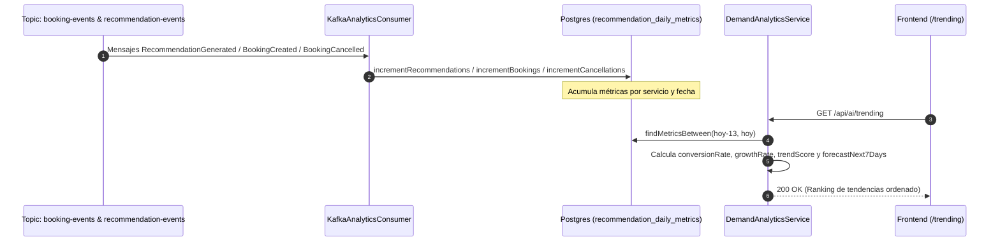

#### 📌 Dónde se ve exactamente en el código:

| Capa | Archivo y Ruta | Líneas | Qué hace en el código |
|---|---|---|---|
| **Consumidor Kafka** | [`KafkaAnalyticsConsumer.java`](file:///C:/Users/santiago/Downloads/SkillBridge-AI-JAVA-Angular/backend/src/main/java/com/riwi/skillbridge/infrastructure/adapter/in/messaging/KafkaAnalyticsConsumer.java) | `L50-L97` (`consumeRecommendationEvent`), `L101-L144` (`consumeBookingEvent`) | Lee eventos en el grupo `skillbridge-analytics-group`, filtra duplicados con `eventRepository.existsById()` y actualiza métricas diarias. |
| **Persistencia de Métricas** | [`RecommendationDailyMetricEntity.java`](file:///C:/Users/santiago/Downloads/SkillBridge-AI-JAVA-Angular/backend/src/main/java/com/riwi/skillbridge/infrastructure/adapter/out/persistence/entity/RecommendationDailyMetricEntity.java) y [`JpaRecommendationDailyMetricRepository.java`](file:///C:/Users/santiago/Downloads/SkillBridge-AI-JAVA-Angular/backend/src/main/java/com/riwi/skillbridge/infrastructure/adapter/out/persistence/repository/JpaRecommendationDailyMetricRepository.java) | `L20-L45` | Tabla `recommendation_daily_metrics` con queries `ON CONFLICT DO UPDATE`. |
| **Cálculo de Algoritmos** | [`DemandAnalyticsService.java`](file:///C:/Users/santiago/Downloads/SkillBridge-AI-JAVA-Angular/backend/src/main/java/com/riwi/skillbridge/application/service/DemandAnalyticsService.java) | `L66-L134` (`getTrending`), `L142-L189` | Fórmulas: `conversionRate` (línea 142), `growthRate` (línea 151), `trendScore` compuesto (línea 162), `forecastNext7Days` (línea 185). |
| **Endpoint REST** | [`AiController.java`](file:///C:/Users/santiago/Downloads/SkillBridge-AI-JAVA-Angular/backend/src/main/java/com/riwi/skillbridge/infrastructure/adapter/in/rest/AiController.java) | `L81-L85` (`trending`) | Expone `GET /api/ai/trending` entregando `List<TrendingServiceResponse>`. |
| **Frontend Angular** | [`trending.component.ts`](file:///C:/Users/santiago/Downloads/SkillBridge-AI-JAVA-Angular/frontend/src/app/features/trending.component.ts) | `L8-L130` | Tabla interactiva con badges porcentuales y forecasts en `/trending`. |

---

## Flujo 5: Creación de Reservas con Idempotencia

Permite a los estudiantes agendar una sesión garantizando protección absoluta contra doble cobro o reservas duplicadas.

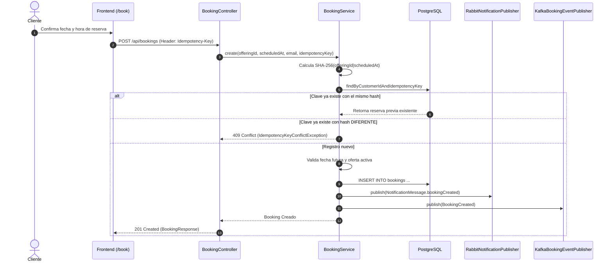

#### 📌 Dónde se ve exactamente en el código:

| Capa | Archivo y Ruta | Líneas | Qué hace en el código |
|---|---|---|---|
| **Controlador REST** | [`BookingController.java`](file:///C:/Users/santiago/Downloads/SkillBridge-AI-JAVA-Angular/backend/src/main/java/com/riwi/skillbridge/infrastructure/adapter/in/rest/BookingController.java) | `L40-L55` (`create`) | Extrae encabezado `@RequestHeader("Idempotency-Key") String idempotencyKey`. |
| **Servicio de Aplicación** | [`BookingService.java`](file:///C:/Users/santiago/Downloads/SkillBridge-AI-JAVA-Angular/backend/src/main/java/com/riwi/skillbridge/application/service/BookingService.java) | `L53-L93` (`createInternal`) | Verifica idempotencia y hash (líneas 68-78); valida fecha futura (líneas 95-104); persiste reserva (línea 86); publica a RabbitMQ (línea 87); publica a Kafka (líneas 88-92). |
| **Hash SHA-256 de Solicitud** | [`BookingService.java`](file:///C:/Users/santiago/Downloads/SkillBridge-AI-JAVA-Angular/backend/src/main/java/com/riwi/skillbridge/application/service/BookingService.java) | `L106-L116` (`requestHash`) | Genera hash criptográfico de los parámetros para detectar mutaciones bajo la misma clave de idempotencia. |
| **Entidad de Dominio** | [`Booking.java`](file:///C:/Users/santiago/Downloads/SkillBridge-AI-JAVA-Angular/backend/src/main/java/com/riwi/skillbridge/domain/model/Booking.java) | `L10-L35` | Modelo de dominio puro en Java sin dependencias de frameworks con estado inicial `BookingStatus.CREATED`. |
| **Frontend Angular** | [`booking.component.ts`](file:///C:/Users/santiago/Downloads/SkillBridge-AI-JAVA-Angular/frontend/src/app/features/booking.component.ts) | `L30-L90` | Pantalla de agendamiento en `/book` que genera un UUID v4 para el `Idempotency-Key`. |

---

## Flujo 6: Cancelación de Reservas y Liberación de Cupo

Permite a los usuarios cancelar una reserva aplicando las políticas de cancelación de la plataforma.

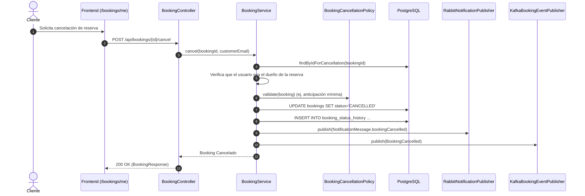

#### 📌 Dónde se ve exactamente en el código:

| Capa | Archivo y Ruta | Líneas | Qué hace en el código |
|---|---|---|---|
| **Controlador REST** | [`BookingController.java`](file:///C:/Users/santiago/Downloads/SkillBridge-AI-JAVA-Angular/backend/src/main/java/com/riwi/skillbridge/infrastructure/adapter/in/rest/BookingController.java) | `L58-L68` (`cancel`) | Endpoint `POST /api/bookings/{id}/cancel`. |
| **Servicio de Aplicación** | [`BookingService.java`](file:///C:/Users/santiago/Downloads/SkillBridge-AI-JAVA-Angular/backend/src/main/java/com/riwi/skillbridge/application/service/BookingService.java) | `L125-L156` (`cancel`) | Comprueba titularidad (línea 131), ejecuta `booking.cancel()` (línea 135), valida política (línea 140), guarda histórico (líneas 142-146), publica a RabbitMQ (línea 147) y publica a Kafka (líneas 148-154). |
| **Política de Cancelación** | [`BookingCancellationPolicy.java`](file:///C:/Users/santiago/Downloads/SkillBridge-AI-JAVA-Angular/backend/src/main/java/com/riwi/skillbridge/domain/service/BookingCancellationPolicy.java) | `L15-L35` (`validate`) | Regla de dominio que rechaza cancelaciones si falta menos del tiempo mínimo estipulado para la sesión. |
| **Historial de Transiciones** | [`BookingStatusHistory.java`](file:///C:/Users/santiago/Downloads/SkillBridge-AI-JAVA-Angular/backend/src/main/java/com/riwi/skillbridge/domain/model/BookingStatusHistory.java) | `L12-L35` | Modela la pista de auditoría temporal en PostgreSQL (`booking_status_history`). |
| **Frontend Angular** | [`my-bookings.component.ts`](file:///C:/Users/santiago/Downloads/SkillBridge-AI-JAVA-Angular/frontend/src/app/features/my-bookings.component.ts) | `L40-L100` | Lista de reservas del usuario en `/bookings/me` con botón de cancelación y confirmación modal. |

---

## Flujo 7: Pagos y Confirmación con Stripe (Webhooks)

Procesa pagos electrónicos de reservas mediante Stripe cumpliendo PCI-DSS (Zero PAN/CVV).

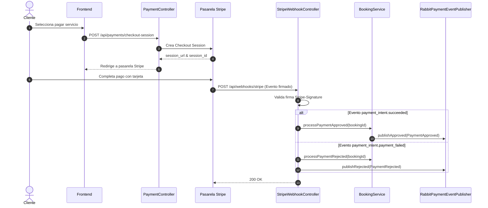

#### 📌 Dónde se ve exactamente en el código:

| Capa | Archivo y Ruta | Líneas | Qué hace en el código |
|---|---|---|---|
| **Controlador de Checkout** | [`PaymentController.java`](file:///C:/Users/santiago/Downloads/SkillBridge-AI-JAVA-Angular/backend/src/main/java/com/riwi/skillbridge/infrastructure/adapter/in/rest/PaymentController.java) | `L25-L45` | Inicia sesión de checkout segura en Stripe. |
| **Controlador de Webhook** | [`StripeWebhookController.java`](file:///C:/Users/santiago/Downloads/SkillBridge-AI-JAVA-Angular/backend/src/main/java/com/riwi/skillbridge/infrastructure/adapter/in/rest/webhook/StripeWebhookController.java) | `L47-L87` (`handleStripeWebhook`) | Recibe el webhook y valida criptográficamente con `Webhook.constructEvent(payload, sigHeader, webhookSecret)`. |
| **Procesador de PaymentIntent** | [`StripeWebhookController.java`](file:///C:/Users/santiago/Downloads/SkillBridge-AI-JAVA-Angular/backend/src/main/java/com/riwi/skillbridge/infrastructure/adapter/in/rest/webhook/StripeWebhookController.java) | `L89-L125` (`processPaymentIntentEvent`) | Extrae `bookingId` de los metadatos; si es exitoso publica `publishApproved` (línea 112); si falla publica `publishRejected` (línea 120). |
| **Publicador RabbitMQ** | [`RabbitPaymentEventPublisher.java`](file:///C:/Users/santiago/Downloads/SkillBridge-AI-JAVA-Angular/backend/src/main/java/com/riwi/skillbridge/infrastructure/adapter/out/messaging/RabbitPaymentEventPublisher.java) | `L22-L29` | Envía `PaymentApproved` y `PaymentRejected` al topic exchange `payment.events`. |
| **Transición de Reserva** | [`BookingService.java`](file:///C:/Users/santiago/Downloads/SkillBridge-AI-JAVA-Angular/backend/src/main/java/com/riwi/skillbridge/application/service/BookingService.java) | `L160-L175` (`processPaymentApproved`) | Cambia el estado de la reserva a `CONFIRMED`. |

---

## Flujo 8: Notificaciones Asíncronas por Email (RabbitMQ)

Desacopla el envío de correos electrónicos transaccionales mediante colas de RabbitMQ.

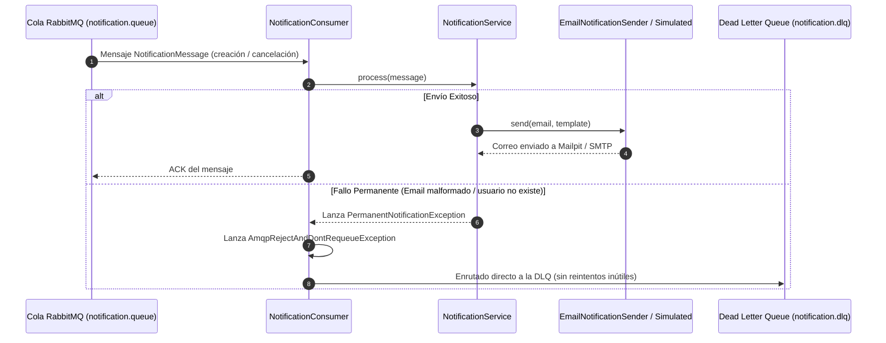

#### 📌 Dónde se ve exactamente en el código:

| Capa | Archivo y Ruta | Líneas | Qué hace en el código |
|---|---|---|---|
| **Topología y Colas** | [`RabbitConfiguration.java`](file:///C:/Users/santiago/Downloads/SkillBridge-AI-JAVA-Angular/backend/src/main/java/com/riwi/skillbridge/infrastructure/config/RabbitConfiguration.java) | `L43-L73` | Define `notificationQueue()` con DLX `notification.dlx` y bindings a `notification.booking.*`. |
| **Publicador RabbitMQ** | [`RabbitNotificationPublisher.java`](file:///C:/Users/santiago/Downloads/SkillBridge-AI-JAVA-Angular/backend/src/main/java/com/riwi/skillbridge/infrastructure/adapter/out/messaging/RabbitNotificationPublisher.java) | `L26-L50` | Envía `NotificationMessage` al topic exchange con correlation data. |
| **Consumidor RabbitMQ** | [`NotificationConsumer.java`](file:///C:/Users/santiago/Downloads/SkillBridge-AI-JAVA-Angular/backend/src/main/java/com/riwi/skillbridge/infrastructure/adapter/in/messaging/NotificationConsumer.java) | `L24-L35` (`onNotification`) | `@RabbitListener(queues = NOTIFICATION_QUEUE)`. En caso de fallo definitivo lanza `AmqpRejectAndDontRequeueException` directo a la DLQ. |
| **Servicio de Notificación** | [`NotificationService.java`](file:///C:/Users/santiago/Downloads/SkillBridge-AI-JAVA-Angular/backend/src/main/java/com/riwi/skillbridge/application/service/NotificationService.java) | `L15-L35` | Resuelve destinatarios y renderiza plantillas de correo. |
| **Emisor SMTP** | [`EmailNotificationSender.java`](file:///C:/Users/santiago/Downloads/SkillBridge-AI-JAVA-Angular/backend/src/main/java/com/riwi/skillbridge/infrastructure/adapter/out/notification/EmailNotificationSender.java) | `L35-L68` | Conecta con Mailpit (puerto 1025) usando `JavaMailSender`. |

---

## Flujo 9: Trazabilidad y Auditoría en Tiempo Real (Kafka + MongoDB + Polling)

Permite al equipo de operaciones y seguridad monitorear todas las transacciones de negocio y seguridad en una consola web en vivo.

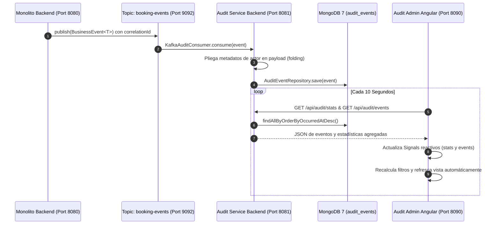

#### 📌 Dónde se ve exactamente en el código:

| Capa | Archivo y Ruta | Líneas | Qué hace en el código |
|---|---|---|---|
| **Captura de Correlation ID** | [`CorrelationIdFilter.java`](file:///C:/Users/santiago/Downloads/SkillBridge-AI-JAVA-Angular/backend/src/main/java/com/riwi/skillbridge/infrastructure/adapter/in/rest/filter/CorrelationIdFilter.java) | `L22-L40` | Vincula `X-Correlation-Id` a SLF4J MDC. |
| **Publicador de Auditoría** | [`KafkaAuditEventPublisher.java`](file:///C:/Users/santiago/Downloads/SkillBridge-AI-JAVA-Angular/backend/src/main/java/com/riwi/skillbridge/infrastructure/adapter/out/messaging/KafkaAuditEventPublisher.java) | `L23-L40` | Publica en el topic `booking-events` de Kafka. |
| **Consumidor Kafka** | [`KafkaAuditConsumer.java`](file:///C:/Users/santiago/Downloads/SkillBridge-AI-JAVA-Angular/audit-service/backend/src/main/java/com/riwi/audit/consumer/KafkaAuditConsumer.java) | `L17-L23` | Escucha `booking-events` y persiste en MongoDB. |
| **Modelo y Plegado Dinámico** | [`BusinessEvent.java`](file:///C:/Users/santiago/Downloads/SkillBridge-AI-JAVA-Angular/audit-service/backend/src/main/java/com/riwi/audit/model/BusinessEvent.java) | `L48-L78` | Pliega campos de actor en el `payload` sin sobrescribir datos previos. |
| **Inicializador de Esquema** | [`AuditMongoInitializer.java`](file:///C:/Users/santiago/Downloads/SkillBridge-AI-JAVA-Angular/audit-service/backend/src/main/java/com/riwi/audit/config/AuditMongoInitializer.java) | `L23-L50` | Crea colección `audit_events` e índices cronológicos. |
| **API REST de Auditoría** | [`AuditController.java`](file:///C:/Users/santiago/Downloads/SkillBridge-AI-JAVA-Angular/audit-service/backend/src/main/java/com/riwi/audit/controller/AuditController.java) | `L24-L51` | Endpoints `GET /events`, `GET /events/{id}`, `GET /stats`. |
| **Cliente Angular** | [`audit.service.ts`](file:///C:/Users/santiago/Downloads/SkillBridge-AI-JAVA-Angular/audit-service/frontend/src/app/audit.service.ts) | `L41-L51` | Cliente HTTP Angular para consumir la API de auditoría. |
| **Polling de 10s en Angular** | [`dashboard.component.ts`](file:///C:/Users/santiago/Downloads/SkillBridge-AI-JAVA-Angular/audit-service/frontend/src/app/dashboard/dashboard.component.ts) | `L154-L177` (`startPolling`) | `interval(10000)` con Signals y `combineLatest`. |

---

## Flujo 10: Gestión de Mentorías y Recursos de Aprendizaje

Permite a mentores y estudiantes gestionar el material pedagógico, metas, salas de Zoom y retroalimentación de sus sesiones.

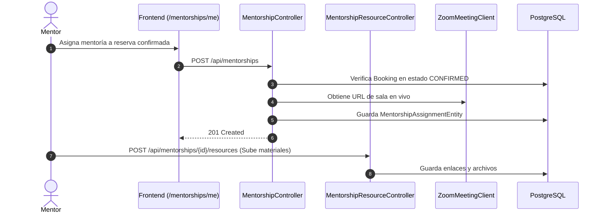

#### 📌 Dónde se ve exactamente en el código:

| Capa | Archivo y Ruta | Líneas | Qué hace en el código |
|---|---|---|---|
| **Controlador de Mentorías** | [`MentorshipController.java`](file:///C:/Users/santiago/Downloads/SkillBridge-AI-JAVA-Angular/backend/src/main/java/com/riwi/skillbridge/infrastructure/adapter/in/rest/MentorshipController.java) | `L37-L40` (`mine`), `L42-L54` (`assign`), `L56-L65` (`updateProgress`) | Endpoint para listar mis mentorías, asignar mentoría tras pago aprobado y actualizar progreso. |
| **Controlador de Recursos** | [`MentorshipResourceController.java`](file:///C:/Users/santiago/Downloads/SkillBridge-AI-JAVA-Angular/backend/src/main/java/com/riwi/skillbridge/infrastructure/adapter/in/rest/MentorshipResourceController.java) | `L30-L65` | Gestión de enlaces, documentos y repositorios compartidos en la mentoría. |
| **Cliente de Zoom** | [`ZoomMeetingClient.java`](file:///C:/Users/santiago/Downloads/SkillBridge-AI-JAVA-Angular/backend/src/main/java/com/riwi/skillbridge/infrastructure/adapter/out/zoom/ZoomMeetingClient.java) | `L20-L45` | Generación y vinculación de la sala de videollamada para la sesión. |
| **Entidad de Asignación** | [`MentorshipAssignmentEntity.java`](file:///C:/Users/santiago/Downloads/SkillBridge-AI-JAVA-Angular/backend/src/main/java/com/riwi/skillbridge/infrastructure/adapter/out/persistence/entity/MentorshipAssignmentEntity.java) | `L15-L55` | Mapeo JPA de la tabla `mentorship_assignments` vinculada a la reserva y al estudiante. |
| **Frontend Angular** | [`my-mentorships.component.ts`](file:///C:/Users/santiago/Downloads/SkillBridge-AI-JAVA-Angular/frontend/src/app/features/my-mentorships.component.ts) | `L25-L115` | Panel de control de mentorías y recursos en `/mentorships/me`. |

---

## Flujo 11: Administración de Usuarios y Control de Acceso (RBAC)

Permite a los administradores de la plataforma supervisar el ecosistema de usuarios y garantizar la seguridad operativa.

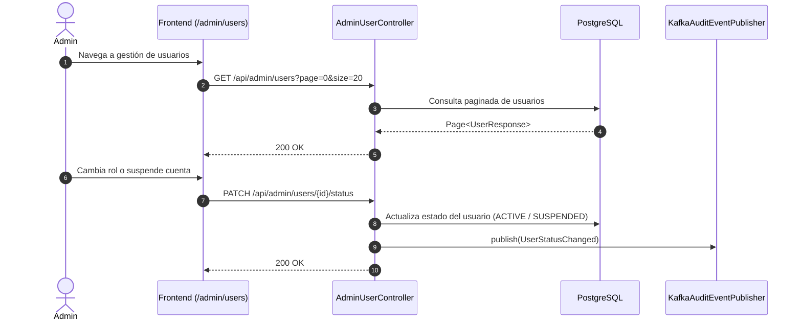

#### 📌 Dónde se ve exactamente en el código:

| Capa | Archivo y Ruta | Líneas | Qué hace en el código |
|---|---|---|---|
| **Controlador Administrativo** | [`AdminUserController.java`](file:///C:/Users/santiago/Downloads/SkillBridge-AI-JAVA-Angular/backend/src/main/java/com/riwi/skillbridge/infrastructure/adapter/in/rest/AdminUserController.java) | `L50-L60` (`list`), `L62-L75` (`changeStatus`), `L77-L90` (`changeRole`) | Protegido con `@PreAuthorize("hasRole('ADMIN')")`. Permite paginar usuarios, suspender cuentas o promover a `PROVIDER`. |
| **Controlador de Ofertas Admin** | [`AdminOfferingController.java`](file:///C:/Users/santiago/Downloads/SkillBridge-AI-JAVA-Angular/backend/src/main/java/com/riwi/skillbridge/infrastructure/adapter/in/rest/AdminOfferingController.java) | `L20-L40` | Moderación de ofertas creadas por instructores. |
| **Reglas de Seguridad Globales** | [`SecurityConfiguration.java`](file:///C:/Users/santiago/Downloads/SkillBridge-AI-JAVA-Angular/backend/src/main/java/com/riwi/skillbridge/infrastructure/config/SecurityConfiguration.java) | `L35-L80` | Configura el `SecurityFilterChain`, desactivando CSRF para API stateless y asignando permisos por ruta. |
| **Eventos de Auditoría** | [`AdminUserController.java`](file:///C:/Users/santiago/Downloads/SkillBridge-AI-JAVA-Angular/backend/src/main/java/com/riwi/skillbridge/infrastructure/adapter/in/rest/AdminUserController.java) | `L72`, `L87` | Emisión obligatoria de eventos de auditoría a Kafka ante cada cambio administrativo. |
| **Frontend Angular** | [`admin-users.component.ts`](file:///C:/Users/santiago/Downloads/SkillBridge-AI-JAVA-Angular/frontend/src/app/features/admin-users.component.ts) | `L30-L120` | Tabla administrativa en `/admin/users` protegida por el guard de roles (`roleGuard('ADMIN')`). |
