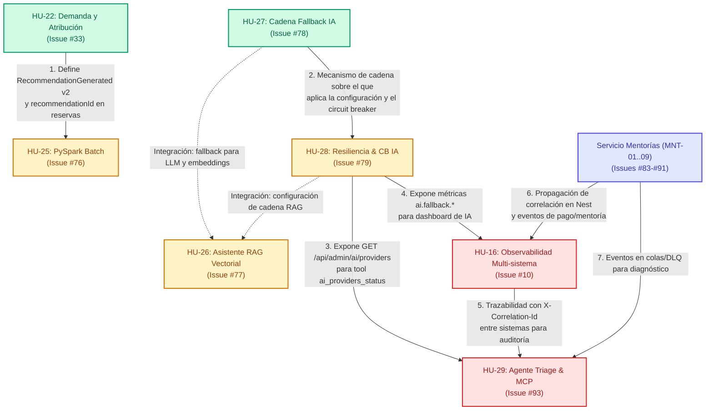

# Matriz y Grafo de Dependencias de HUs Pendientes

**Fecha de actualización:** 2026-11-10  
**Contexto:** Arquitectura híbrida (Monolito Spring Boot + `audit-service` + `mentorship-service` NestJS + Job PySpark).  
**Documento base:** [Refinamiento de HUs (noviembre 2026)](2026-11-hu-refinement.md) y especificaciones en [`specs/`](../../specs/).

Este documento registra exclusivamente las **Historias de Usuario (HUs) pendientes o activas** (en estado Draft, parcial o propuesta), excluyendo todas aquellas que ya están completadas e integradas en la plataforma (`Done`).

---

## 1. Alcance: HUs Excluidas (`Done`) vs. HUs Analizadas (`Pendientes`)

### HUs Excluidas por estar Completadas (`Done`)
- **HU-01 a HU-07:** Catálogo, autenticación JWT básica, creación de reservas, procesamiento asíncrono RabbitMQ, recomendaciones iniciales, entorno Docker Compose y suite de pruebas base.
- **HU-08:** Consultar mis reservas (`GET /api/bookings/me`).
- **HU-09:** Cancelar una reservación propia con reglas de antelación.
- **HU-10:** CI Pull Request y automatización.
- **HU-12:** Notificaciones asíncronas RabbitMQ y Dead Letter Queue.
- **HU-13:** Eventos de negocio con Apache Kafka y control de acceso RBAC.
- **HU-14:** Simulación de pasarela de pago y auditoría de cancelaciones.
- **HU-15:** Abstracción y migración de proveedores de IA (Gemini / OpenAI).
- **HU-17:** Idempotencia y propagación de `X-Correlation-Id`.
- **HU-19:** Gestión de servicios por Provider y Admin.
- **HU-20:** Gestión de usuarios por Admin.
- **HU-21:** Solicitud y verificación de cuenta Provider.
- **HU-23:** Recomendaciones multimodales con IA (voz y visión).
- **HU-24:** Envío de notificaciones por correo electrónico.

### HUs Analizadas (No terminadas)
1. **HU-22:** Análisis predictivo de demanda — cierre de alcance y atribución (Issue [#33](https://github.com/Danilo-Doria/SkillBridge-AI-JAVA-Angular/issues/33)).
2. **HU-27:** Modelos de IA de respaldo / Fallback chain (Issue [#78](https://github.com/Danilo-Doria/SkillBridge-AI-JAVA-Angular/issues/78)).
3. **HU-28:** Configuración, resiliencia y circuit breaker de IA (Issue [#79](https://github.com/Danilo-Doria/SkillBridge-AI-JAVA-Angular/issues/79)).
4. **HU-25:** Batch Analytics con Apache Spark (Issue [#76](https://github.com/Danilo-Doria/SkillBridge-AI-JAVA-Angular/issues/76)).
5. **HU-26:** Asistente de Conocimiento con RAG y Almacén Vectorial (Issue [#77](https://github.com/Danilo-Doria/SkillBridge-AI-JAVA-Angular/issues/77)).
6. **HU-16:** Observabilidad distribuida multi-sistema (Issue [#10](https://github.com/Danilo-Doria/SkillBridge-AI-JAVA-Angular/issues/10)).
7. **HU-29:** Triage de incidentes con Agente IA y Servidor MCP (Issue [#93](https://github.com/Danilo-Doria/SkillBridge-AI-JAVA-Angular/issues/93)).
8. *(Contexto satélite)*: Migración de Mentorías (**MNT-01 a MNT-09**, Issues #83–#91).

---

## 2. Grafo Visual de Dependencias



---

## 3. Matriz Resumen de Dependencias

| HU | Nombre | Estado | Depende de | Prerrequisito para | Tipo de Dependencia |
|---|---|---|---|---|---|
| **HU-22** | Análisis Predictivo de Demanda | Parcial (cierre de alcance) | *Ninguna* (usa reservas y recomendaciones ya existentes) | **HU-25** | **Bloqueante semántica:** define el contrato de eventos v2 y la atribución para datos reales. |
| **HU-27** | Modelos de IA de respaldo (Fallback) | Draft (Spec aprobable) | *Ninguna* (usa adaptadores de HU-15/23) | **HU-28**, **HU-26**, **HU-29** | **Bloqueante arquitectural:** HU-28 instrumenta la cadena que HU-27 crea. |
| **HU-28** | Configuración y Resiliencia de IA | Draft (Spec aprobable) | **HU-27** | **HU-16**, **HU-29**, **HU-26** | **Bloqueante funcional:** provee endpoint administrativo y métricas requeridas. |
| **HU-25** | Batch Analytics con Apache Spark | Draft (Spec aprobable) | **HU-22** | *Ninguna* | **Bloqueante de datos reales:** Spark puede probarse con datos sintéticos, pero requiere HU-22 para procesar datos de negocio. |
| **HU-26** | Asistente de Conocimiento con RAG | Draft (Spec aprobable) | **HU-27**, **HU-28** *(Requisito de integración)* | *Ninguna* | **Integración:** puede arrancar con proveedor simple, pero la versión final exige fallback para LLM y embeddings. |
| **HU-16** | Observabilidad multi-sistema | Parcial | **HU-28**, **MNT** | **HU-29** | **Bloqueante funcional:** provee dashboards y correlación extremo a extremo que HU-29 necesita para diagnosticar. |
| **HU-29** | Triage de incidentes con Agente IA / MCP | Draft (Propuesta) | **HU-16**, **HU-28**, `audit-service` (FR-014) | *Ninguna* | **Bloqueante múltiple:** consume herramientas basadas en la correlación de HU-16 y el endpoint admin de HU-28. |

---

## 4. Análisis Detallado por Funcionalidad

### 4.1 HU-22 — Análisis Predictivo de Demanda (Cierre de alcance)
- **Especificación:** [`specs/022-demand-analytics/spec.md`](../../specs/022-demand-analytics/spec.md)
- **Por qué no está terminada:** La entrega previa contiene un defecto verificado: `RecommendationGenerated` no incluía las ofertas recomendadas, el consumidor agregaba por `userId` en lugar de `offeringId`, y la reserva carecía de `recommendationId`.
- **Dependencias entrantes:** Ninguna de las pendientes.
- **Dependencias salientes:** Bloquea a **HU-25**. Los cálculos batch de Spark no pueden computar la tasa de conversión oficial sobre datos reales sin la atribución formal (`recommendationId`) introducida en HU-22.

### 4.2 HU-27 — Modelos de IA de Respaldo (AI Model Fallback)
- **Especificación:** [`specs/027-ai-model-fallback/spec.md`](../../specs/027-ai-model-fallback/spec.md)
- **Alcance:** Entrega 1 de la resiliencia de IA. Introduce adaptadores compuestos por puerto (`AiRecommendationPort`, `VisionPort`, `SpeechToTextPort`, `TextToSpeechPort`) y conmutación secuencial ante errores recuperables (429, 5xx, timeouts). Prohíbe respuestas mock (error 503 controlado).
- **Dependencias entrantes:** Ninguna de las pendientes.
- **Dependencias salientes:** Bloquea directamente a **HU-28**.

### 4.3 HU-28 — Configuración, Circuit Breaker y Resiliencia de IA
- **Especificación:** [`specs/028-ai-fallback-config/spec.md`](../../specs/028-ai-fallback-config/spec.md)
- **Alcance:** Entrega 2 de la resiliencia de IA. Configuración declarativa `app.ai.fallback.*`, validación fail-fast al boot, Circuit Breakers con Resilience4j, métricas Micrometer (`ai.fallback.attempts`, `ai.fallback.provider.used`) y endpoint seguro `GET /api/admin/ai/providers` (`ROLE_ADMIN`).
- **Dependencias entrantes:** **HU-27** (la configuración opera sobre la cadena de HU-27).
- **Dependencias salientes:**
  - Bloquea a **HU-29** (herramienta `ai_providers_status`).
  - Bloquea a **HU-16** (panel de resiliencia de IA en Grafana).

### 4.4 HU-25 — Batch Analytics con Apache Spark
- **Especificación:** [`specs/025-spark-analytics/spec.md`](../../specs/025-spark-analytics/spec.md)
- **Contrato:** [`docs/contracts/analytics-events.md`](../contracts/analytics-events.md)
- **Alcance:** Pipeline batch PySpark desacoplado en `analytics/spark/`, lectura de ficheros JSONL exportados y persistencia en Parquet particionado.
- **Dependencias entrantes:** **HU-22** (contrato semántico de métricas de conversión y eventos v2 `RecommendationGenerated`, `BookingCreated` y `BookingCancelled`).

### 4.5 HU-26 — Asistente de Conocimiento con RAG
- **Especificación:** [`specs/026-rag-knowledge/spec.md`](../../specs/026-rag-knowledge/spec.md)
- **Alcance:** Endpoint `POST /api/ai/knowledge/ask` con embeddings multilingües (Gemini) y almacén vectorial (pgvector, ADR-0008), citación estricta y rechazo determinista ante contexto insuficiente.
- **Dependencias:**
  - **HU-27 / HU-28 (Integración):** RAG puede desarrollarse con el adaptador básico de IA, pero su cierre productivo requiere el fallback para la llamada LLM y para el proveedor de embeddings (`capacity: embedding`).
  - **Base de Datos:** Coordinar numeración de la migración Flyway de pgvector con la migración de `recommendationId` de HU-22.

### 4.6 HU-16 — Observabilidad Multi-sistema
- **Documento:** [`docs/refinement/2026-11-hu-refinement.md` §4](2026-11-hu-refinement.md#4-hu-16--observabilidad-10)
- **Alcance:** Dashboards centralizados en Grafana raspando Actuator (monolito y audit) y `/metrics` (NestJS), monitoreo de lag en colas (Kafka/RabbitMQ) y DLQs.
- **Dependencias entrantes:**
  - **HU-28:** Requiere las métricas `ai.fallback.*` para la pestaña de salud de IA.
  - **MNT:** Requiere propagación del `X-Correlation-Id` en el microservicio de mentorías.

### 4.7 HU-29 — Triage de Incidentes con Agente IA & Servidor MCP
- **Especificación:** [`specs/029-incident-triage-agent/spec.md`](../../specs/029-incident-triage-agent/spec.md)
- **Alcance:** Servidor MCP en Java (`mcp-triage/server`) de solo lectura y agente consumidor CLI (`mcp-triage/agent`) para diagnosticar fallos cruzados con prueba de utilidad obligatoria frente a línea base determinista.
- **Dependencias entrantes:**
  - **HU-16:** Requiere la correlación distribuida multi-sistema.
  - **HU-28:** Requiere el endpoint `GET /api/admin/ai/providers` para la herramienta `ai_providers_status`.
  - **HU-27 / HU-28:** El agente invoca el LLM a través de los puertos de IA protegidos por el fallback.
  - **Prerrequisito técnico en `audit-service` (FR-014):** Se debe implementar el endpoint `GET /api/audit/events?correlationId=...` antes de habilitar la herramienta `audit_by_correlation`.

---

## 5. Ruta de Ejecución Recomendada (Roadmap)

Para optimizar el esfuerzo de desarrollo y evitar bloqueos entre células o agentes:

```text
Fase 1 (Fundaciones independientes)
  ├── HU-22: Corrección de eventos v2, recommendationId y atribución
  └── HU-27: Adaptador compuesto y conmutación de IA por puerto

Fase 2 (Resiliencia y procesamiento batch)
  ├── HU-28: Circuit breaker con Resilience4j, configuración y endpoint admin (desbloqueado por HU-27)
  └── HU-25: Job PySpark sobre datasets JSONL de eventos v2 (desbloqueado por HU-22)

Fase 3 (Capacidades de conocimiento y observabilidad transversal)
  ├── HU-26: RAG con pgvector integrado a la cadena de fallback de HU-27/28
  └── HU-16: Dashboard multi-servicio con métricas de HU-28 y colas

Fase 4 (Diagnóstico agéntico)
  └── HU-29: Servidor MCP y agente CLI de triage (consume HU-16, HU-28 y audit-service)
```
